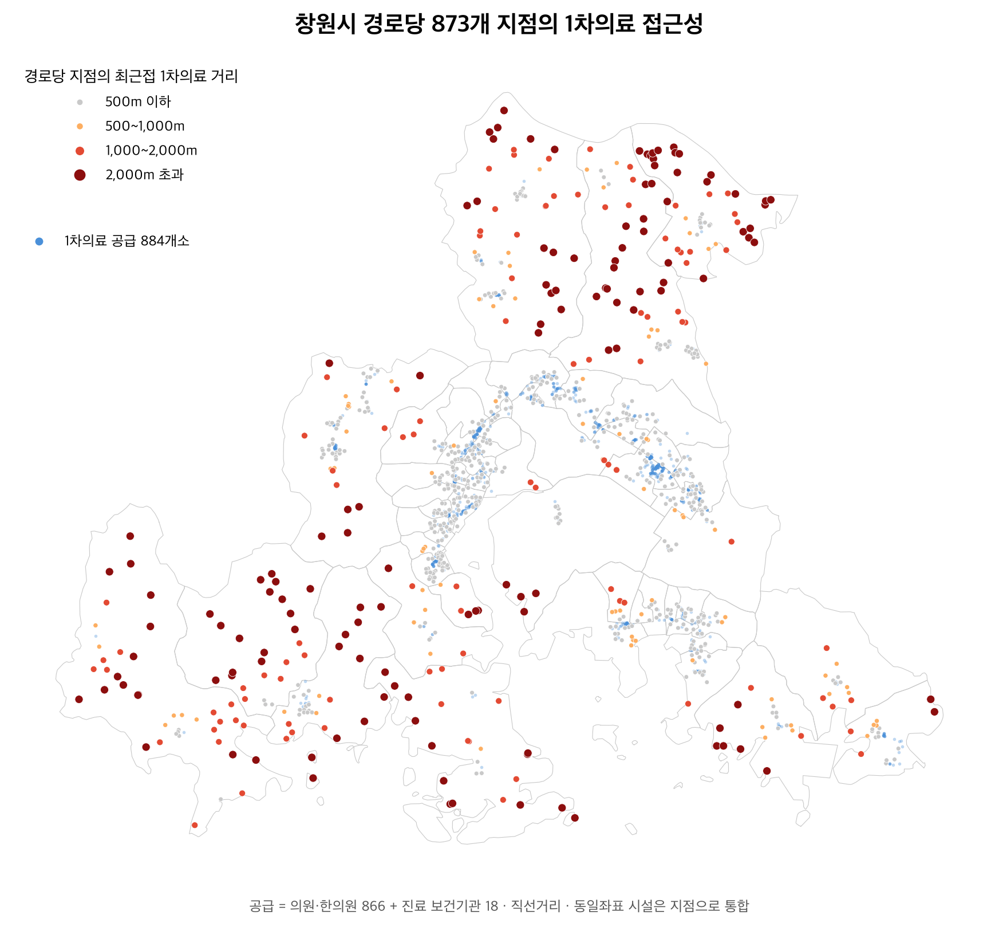
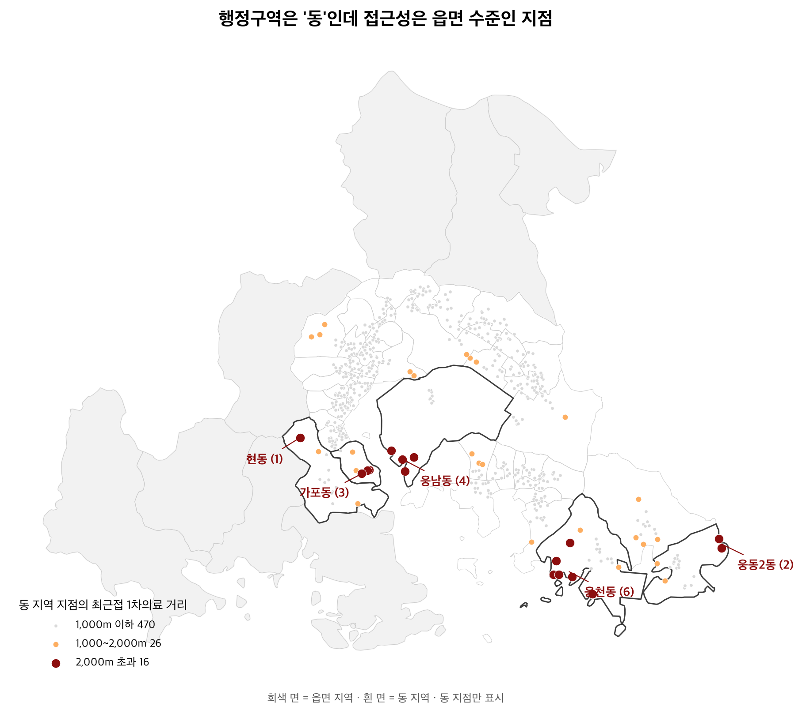
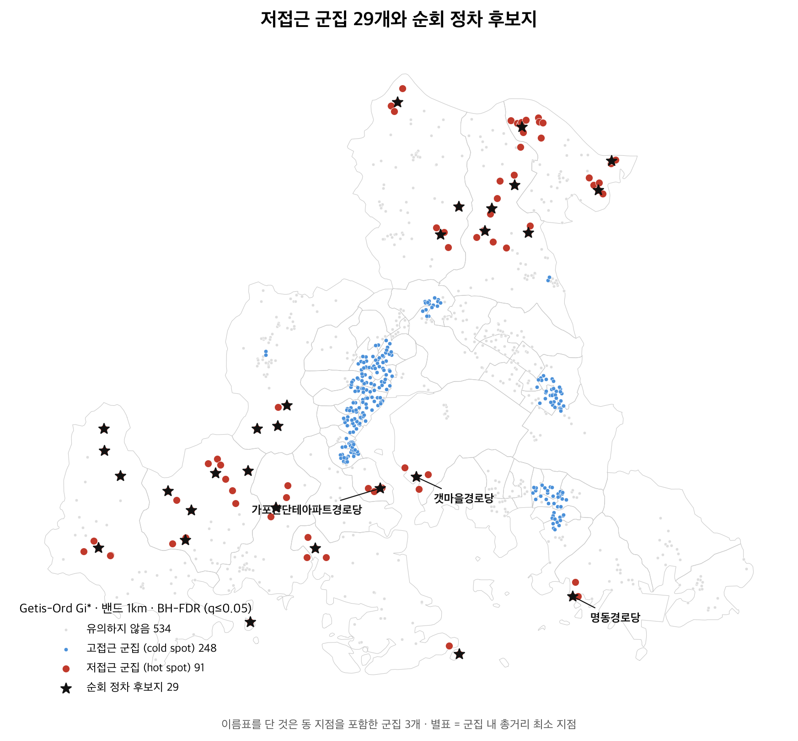
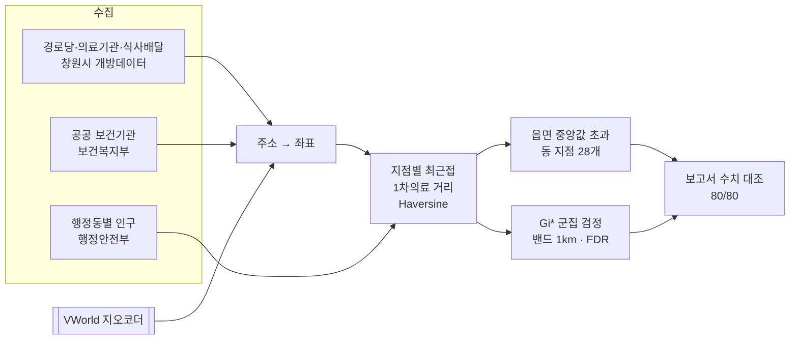

<div align="center">

# 동네 안에 읍면

**행정구역은 '동'인데 의료 접근성은 읍면 수준인 곳**

창원시 경로당 873개 지점에서 가장 가까운 1차의료기관까지의 거리를 재서,
행정동 평균에 가려진 취약 지점을 방문건강관리 현장 확인 대상으로 찾아냅니다.


2026년 창원시 AI·데이터 활용 공모전 출품작 · 팀 **동네 안에 읍면** (김종건 · 김상현, 순천향대학교 컴퓨터소프트웨어공학과)

</div>

> [!IMPORTANT]
> **이 분석은 현장 확인 '후보'를 제시합니다. 대상자를 확정하지 않습니다.**
> 거리는 경로당과 의료기관 사이의 직선거리입니다. 후보 목록이 실제 누락을 바로잡는지는 담당 부서가 대상 명부와 대조한 뒤에야 알 수 있습니다.

---

## 목차

- [분석 배경](#분석-배경)
- [주요 결과](#주요-결과)
- [지도](#지도)
- [분석 방법](#분석-방법)
- [정책 활용](#정책-활용)
- [재현 방법](#재현-방법)
- [검증](#검증)
- [데이터 출처](#데이터-출처)
- [공개본에서 뺀 것](#공개본에서-뺀-것)
- [프로젝트 구조](#프로젝트-구조)
- [라이선스](#라이선스)

---

## 분석 배경

지역보건의료계획의 현황분석은 행정동 단위 통계를 기본 자료로 씁니다. 그러나 창원시 55개 행정동 가운데는 도심 아파트 단지와 산간 자연마을을 함께 품은 곳이 있고, 행정동 평균은 둘을 한 값으로 섞습니다.

| 문제 | 이 분석의 접근 |
|------|--------------|
| 행정동 평균이 동네 안의 차이를 가린다 | 경로당 **지점 단위**(873개)로 거리를 잰다. 행정동 수의 약 16배 해상도 |
| 읍면 단위 사업 지정은 '동' 안의 원거리 지점을 놓친다 | 읍면 지점의 거리 중앙값(1,310m)을 '읍면 수준'으로 정의하고, 그보다 먼 **동 지점**을 찾는다 |
| 개방된 의료기관 현황에 보건소·보건지소·보건진료소가 빠져 있다 | 보건복지부 지역보건의료기관 현황으로 공공 보건기관 18곳을 보충한다 |
| 원거리 지점의 분포가 우연일 수 있다 | Getis-Ord Gi\* 공간 군집 검정(FDR 보정)으로 권역 단위의 저접근을 확인한다 |

---

## 주요 결과

| 지표 | 값 |
|------|---:|
| 분석 지점 (경로당 1,035개소의 동일좌표 통합) | 873 |
| 1차의료 공급 (의원 594 + 한의원 272 + 공공 보건기관 18) | 884 |
| 경로당 → 1차의료 거리 중앙값 (시설 단위) | 303m |
| 1km 넘는 지점 | 242 (27.7%) — 읍면 200 · 동 42 |
| 읍면 지점 거리 중앙값 = '읍면 수준' | 1,310m |
| **읍면 수준보다 먼 동 지점** | **28** (동 512개의 5.5%, 1,366m ~ 4,537m) |
| Gi\* 저접근 군집 (밴드 1km 연결요소) | 29 |

28개 지점은 진해구 웅천동(7)·성산구 웅남동(4)·마산합포구 가포동(4)·진해구 웅동2동(3)·마산회원구 회성동(3)·마산합포구 현동(2) 등 11개 행정동에 있습니다. 창원시 전체의 1차의료 접근성은 양호합니다. 문제는 평균이 아니라 분포의 꼬리에 있는 지점입니다.

---

## 지도

배경 지도 타일 없이 경로당과 의료기관의 점만으로 그렸습니다.

<table>
  <tr>
    <td align="center" width="33%">
      <br/>
      <sub><b>그림 1. 전체 접근성</b><br/>873개 지점의 최근접 거리 구간</sub>
    </td>
    <td align="center" width="33%">
      <br/>
      <sub><b>그림 2. 동 지역 취약 지점</b><br/>읍면 중앙값을 넘는 동 지점 28개</sub>
    </td>
    <td align="center" width="33%">
      <br/>
      <sub><b>그림 3. 저접근 군집</b><br/>Gi* 유의 권역 29개와 정차 후보지</sub>
    </td>
  </tr>
</table>

> 지점 좌표: 국토교통부 공간정보 오픈플랫폼(VWorld) 지오코더 · 행정경계: 통계청 SGIS(vuski/admdongkor)

---

## 분석 방법



| 단계 | 설정 | 이유 |
|------|------|------|
| 분석 단위 | 경로당 지점 873개 (시설 1,035개소 병기) | 같은 좌표를 쓰는 남녀·단지 내 경로당은 한 번 방문하므로 지점으로 합친다 |
| 지표 | 최근접 1차의료 직선거리 (Haversine, 반올림 전 값으로 임계 판정) | 의료기관 원본에 읍면동이 없어 행정동별 개수는 42.2%가 특정 불가. 거리는 공급지점의 행정동이 필요 없다 |
| 고령 기준 | 70세 이상 | 인구 데이터가 10세 단위라 65세 경계를 만들 수 없다. 과소추정 쪽(보수적)을 택했다 |
| 군집 검정 | Getis-Ord Gi\*, 거리 밴드 1,000m 이진 가중, Benjamini-Hochberg FDR α=0.05 | 순회진료·방문건강관리는 권역 단위로 움직인다 |
| 쓰지 않은 것 | 2SFCA, AI 예측 모델 | 공급량(의사 수)과 지점별 수요가 데이터에 없다. 873개 거리 위의 분류기는 분석자가 정한 라벨을 다시 맞히는 순환이 된다 |

외부 공간분석 라이브러리 없이 표준 라이브러리와 numpy로 직접 구현했습니다.

---

## 정책 활용

부서와 주기는 창원시 「조직 및 기능」 페이지의 분장사무에서 직접 확인했습니다.

| 부서 | 무엇에 쓰는가 | 주기 |
|------|--------------|------|
| 창원·마산·진해보건소 보건정책·보건행정팀 | 지역보건의료계획 현황분석의 취약지 근거자료 | 4년 주기 + 매년 연차별 시행계획 (지역보건법 제7조) |
| 창원·진해보건소 치매관리팀 (마산은 담당팀 미확인) | 방문건강관리 대상 발굴 때 동 지역 28개 지점을 현장 확인 대상에 포함 | 연 1회 |
| 복지여성보건국 노인장애인과 | 경로당 현황에 좌표·접근성 열 병기 | 연 1회 |

전체 근거와 현장 확인 절차는 [제출 보고서](05_제출본/)의 「활용방안 및 기대효과」에 있습니다.

---

## 재현 방법

### 준비물

- Python 3.14 (패키지 버전은 `03_분석/requirements.txt`에 고정)
- VWorld 인증키 — [vworld.kr](https://www.vworld.kr) › 오픈API › 인증키 발급. 서비스유형 `기타`, 서비스URL `http://localhost`, 활용API `지오코더`

### 1. 환경

```bash
python3 -m venv .venv && .venv/bin/pip install -r 03_분석/requirements.txt
cp .env.example .env    # VWORLD_KEY 를 채운다
```

### 2. 수집 → 분석 → 검증

```bash
.venv/bin/python 03_분석/00_수집_역대수상작_요약서.py       # 역대 수상작 요약서 (창원시 데이터포털)
python3 03_분석/01_수집_창원데이터포털_카탈로그.py
python3 03_분석/02_집계_도메인_판정.py
python3 03_분석/03_실측_후보데이터_프로파일.py            # 분석 데이터 원본 수집
python3 03_분석/04_정제_지오코딩.py                      # 주소 → 좌표 (VWORLD_KEY 필요)
python3 03_분석/05_실측_인구데이터.py --month 202606      # 제출본 기준월
python3 03_분석/07_수집_보건기관.py --file-id FILE_000000003692397   # 제출본 첨부파일, 좌표화 포함
python3 03_분석/06_분석_접근성.py                        # 07번 산출물을 읽는다 — 07 다음에 실행
.venv/bin/python 03_분석/08_분석_군집.py
.venv/bin/python 03_분석/09_시각화_지도.py
python3 03_분석/10_검증_숫자대조.py --report 04_보고서/제출본_분석보고서_본문.md
python3 03_분석/13_검증_표절대조.py --report 04_보고서/제출본_분석보고서_본문.md
```

> [!NOTE]
> 위 명령은 **최신 원본으로 다시 분석하는 경로**입니다. 제출 당시와 같은 값을 보장하지 않습니다.

| 단계 | 제출 당시 입력 고정 | 비고 |
|------|------|------|
| 05 인구 | 됨 (`--month 202606`) | |
| 07 보건기관 | 됨 (`--file-id`) | |
| 03 경로당·의료기관·식사배달 | **안 됨** | 포털의 최신 첨부파일을 받는다. 제출 당시 파일명·기준시점은 `02_데이터/clean/후보데이터_프로파일.json`에 있다 |
| 04·07 좌표 | **안 됨** | 제출 당시 좌표(지오코딩 캐시)는 공개본에 없고, VWorld의 현재 응답을 받는다 |

> [!NOTE]
> `04`번은 네트워크 오류가 난 주소도 캐시에 `ERROR:…` 상태로 남기고 정상 종료합니다. `02_데이터/clean/지오코딩_실패목록.csv`의 실패사유가 `ERROR:`로 시작하는 행이 있을 때만 `04 --refresh`로 다시 조회합니다(`NOT_FOUND`는 다시 조회해도 같습니다). `--refresh`는 보건기관 주소까지 든 캐시 전체를 새로 만들므로, 그 뒤 `07`부터 다시 실행합니다.

### 스크립트 모음

| 스크립트 | 역할 |
|---------|------|
| `00` `01` `02` | 역대 수상작·데이터 재고 조사와 도메인 판정 |
| `03` | 분석 데이터 원본 수집과 프로파일 |
| `04` | VWorld 지오코딩 (캐시·실패목록·리포트) |
| `05` | 행정동별 인구 |
| `07` | 공공 보건기관 수집·좌표화 |
| `06` | 지점별 최근접 거리와 민감도 |
| `08` | Gi\* 군집 검정 |
| `09` | 지도 3장 |
| `10` | 보고서 본문 수치를 데이터에서 다시 계산해 대조 |
| `13` | 역대 수상작 요약서와 어절 단위 대조 (표절 자체검증) |
| `11` `12` `15` `17` | 보고서 조판·매수 측정 도구 |

각 스크립트 첫머리 주석에 입력·출력·재현 명령이 있습니다.

---

## 검증

| 검사 | 결과 | 기록 |
|------|------|------|
| 보고서 본문 수치를 정제 데이터에서 다시 계산해 대조 | 80건 중 80건 일치 | [`03_분석/숫자대조표.md`](03_분석/숫자대조표.md) |
| 역대 수상작 요약서 20개 파일과 5어절·8어절 연속 일치 | 0건 | [`03_분석/표절대조표.md`](03_분석/표절대조표.md) |
| 임계(500m~2km)·공급 정의·집계 단위·군집 밴드 민감도, 거리 기준과 Gi\* 결과의 일치도, 좌표 실패의 영향, 거리 0m 구간 점검 | 보고서 「검증」 (1)~(7) | [`05_제출본/`](05_제출본/) |

---

## 데이터 출처

| 데이터 | 제공 | 출처 | 이용조건 |
|------|------|------|------|
| 경로당 현황 | 창원시 노인장애인과 | 공공데이터포털 3077748 / 창원시 데이터포털 | 이용허락범위 제한없음 |
| 재가노인 식사배달사업자 현황 | 창원시 노인장애인과 | 창원시 데이터포털 | 이용허락범위 제한없음 |
| 의료기관 현황 (의창·성산 / 마산합포·회원 / 진해) | 창원시 보건정책과 · 마산보건소 · 진해보건소 | 공공데이터포털 / 창원시 데이터포털 | 이용허락범위 제한없음 |
| 전국 지역보건의료기관 현황 | 보건복지부 | [공공데이터포털 3072692](https://www.data.go.kr/data/3072692/fileData.do) | 이용허락범위 제한없음 |
| 행정동별 성·연령별 주민등록 인구 | 행정안전부 | 공공데이터포털 (기준월 2026-06) | 이용허락범위 제한없음 |
| 행정동 경계 | 통계청 SGIS (원자료) | [vuski/admdongkor](https://github.com/vuski/admdongkor) ver20260701 | CC BY 4.0 · 원자료 공공누리 제1유형 |
| 주소 좌표 변환 | 국토교통부 공간정보 오픈플랫폼(VWorld) | Geocoder API | 좌표 숫자는 공개본에 없음, 지도로만 표출 |

이용조건은 취득 당시(2026-09) 각 포털 표기를 옮긴 것입니다. 재사용 전에 현재 표기를 다시 확인하세요.
`02_데이터/clean/창원_행정동_경계.geojson`은 vuski/admdongkor(CC BY 4.0)에서 창원시 행정동만 추출한 것입니다.

---

## 공개본에서 뺀 것

| 무엇 | 왜 | 다시 만드는 법 |
|------|------|------|
| 역대 수상작 요약서 원문 텍스트 | 다른 팀의 저작물이다 | `00`번 |
| 좌표 숫자가 든 표 (`지오코딩_캐시`, `경로당·의료기관·보건기관·식사배달기관_좌표`, `경로당_접근성`, `경로당_군집`) | VWorld 지오코더 결과의 재배포 조건을 확인하지 못했다 | `04` → `07` → `06` → `08` (VWORLD_KEY 필요) |

다시 만든 파일은 `.gitignore`에 들어 있어 커밋되지 않습니다. 보고서에는 "지오코딩 캐시로 인증키 없이 같은 좌표가 나온다"고 적었으나, 그 캐시는 위 이유로 공개본에 없습니다. 공개 검증 기간에 요청하면 제공합니다.

---

## 프로젝트 구조

```
changwon-senior-care-access/
├── 01_공고·서식/          공모전 공고문·제출 서식 원본 (창원시 배포)
├── 02_데이터/
│   └── clean/             정제 결과 중 공개하는 것 (경계·인구·매핑·실패목록·프로파일)
├── 03_분석/               수집·정제·분석·검증 스크립트(00~17)와 분석 노트
├── 04_보고서/             보고서 원고(md)·조판 템플릿·그림
├── 05_제출본/             실제 제출한 분석보고서 (hwpx · pdf, 2026-09-29, A4 18매)
├── .env.example           VWORLD_KEY
└── LICENSE                코드(03_분석/*.py)에만 적용
```

`02_데이터/raw/`는 저장소에 없습니다. 스크립트가 포털에서 다시 받습니다.

---

## 라이선스

- 코드(`03_분석/*.py`): [MIT](LICENSE). LICENSE는 코드에만 적용됩니다.
- 분석보고서·문서·그림(`04_보고서/`, `05_제출본/`, `03_분석/*.md`): © 2026 김종건·김상현. All rights reserved. 공모전 요강에 따라 저작권은 응모자에게 있습니다.
- 데이터: 위 표의 각 출처 이용조건을 따릅니다.
- `01_공고·서식/`: 창원시 배포 원본입니다.
